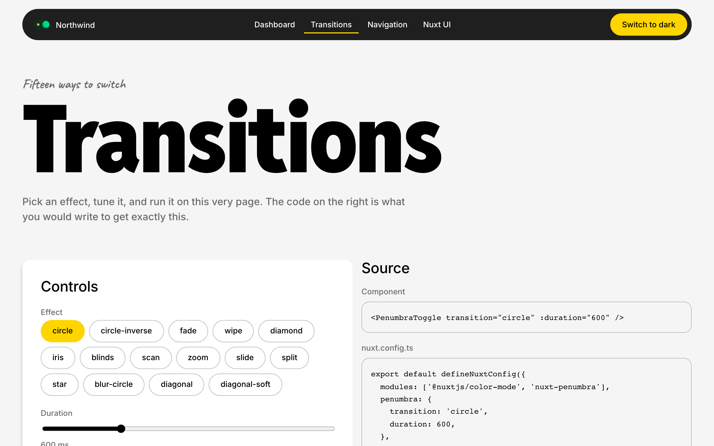
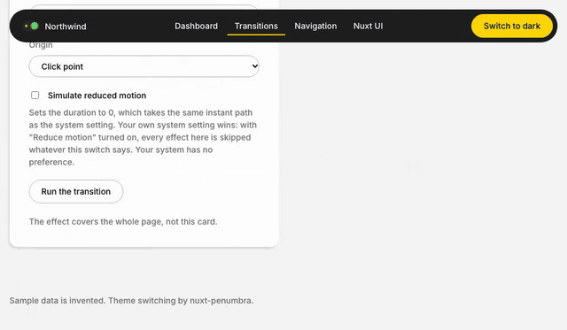
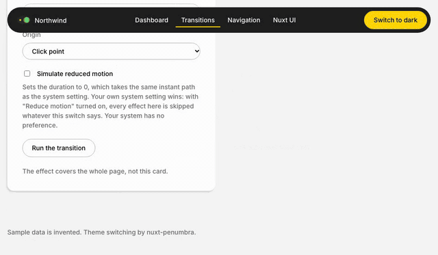

<p align="center">
  
</p>

# nuxt-penumbra

[](https://www.npmjs.com/package/nuxt-penumbra)
[](https://github.com/jantursky/nuxt-penumbra/actions/workflows/ci.yml)
[](https://codecov.io/gh/jantursky/nuxt-penumbra)
[](LICENSE)

Animated theme switching for Nuxt, built on the View Transitions API. A circle that grows from the button you clicked, a wipe, blinds, a fade, or an effect you write yourself.

[Docs](https://nuxt-penumbra-docs.vercel.app) · [Demo](https://nuxt-penumbra.vercel.app) · [npm](https://www.npmjs.com/package/nuxt-penumbra) · [Changelog](packages/nuxt-penumbra/CHANGELOG.md)

<a href="https://nuxt-penumbra.vercel.app">
  <picture>
    <source media="(prefers-color-scheme: dark)" srcset=".github/assets/transitions-dark.png">
    
  </picture>
</a>

`@nuxtjs/color-mode` keeps the preference, the storage and the no-flash script, but it cannot animate a switch, and Nuxt UI turns its own transitions off. nuxt-penumbra adds the animation layer on top of what you already use. Without color-mode it keeps a small theme store of its own.

## Install

```bash
npm install nuxt-penumbra @nuxtjs/color-mode
```

```ts
// nuxt.config.ts
export default defineNuxtConfig({
  modules: ['@nuxtjs/color-mode', 'nuxt-penumbra'],
  colorMode: { classSuffix: '' },
  penumbra: { transition: 'circle', duration: 500 },
})
```

```vue
<script setup lang="ts">
const { theme, toggleTheme } = usePenumbra()
</script>

<template>
  <button @click="(event) => toggleTheme({ origin: event })">Theme: {{ theme }}</button>
  <PenumbraToggle transition="wipe" />
</template>
```

Nuxt UI's `UColorModeButton`, `UColorModeSwitch` and `UColorModeSelect` are animated as they are, with no wrapper. Without `@nuxtjs/color-mode` in `modules`, the module runs in standalone mode: it stores the choice in `localStorage`, follows `prefers-color-scheme`, and puts a small script in `<head>` so the page never shows the wrong theme.

## Transitions

Fifteen effects ship with the module. They come from [`@penumbra/core`](https://github.com/jantursky/astro-eclipse/tree/main/packages/core), the engine that [astro-eclipse](https://github.com/jantursky/astro-eclipse) uses too, so names and options match. Register your own with `definePenumbraTransition`.

<table>
<tr><th>Name</th><th>Preview</th></tr>
<tr><td><code>circle</code></td><td></td></tr>
<tr><td><code>circle-inverse</code></td><td></td></tr>
<tr><td><code>wipe</code></td><td></td></tr>
<tr><td><code>diamond</code></td><td></td></tr>
<tr><td><code>iris</code></td><td></td></tr>
<tr><td><code>blinds</code></td><td></td></tr>
<tr><td><code>blur-circle</code></td><td></td></tr>
<tr><td><code>star</code></td><td></td></tr>
<tr><td><code>diagonal</code></td><td></td></tr>
<tr><td><code>diagonal-soft</code></td><td></td></tr>
<tr><td><code>split</code></td><td></td></tr>
<tr><td><code>scan</code></td><td></td></tr>
<tr><td><code>slide</code></td><td></td></tr>
<tr><td><code>zoom</code></td><td></td></tr>
<tr><td><code>fade</code></td><td></td></tr>
</table>

## How it works

1. `src/module.ts` waits until every module is set up (Nuxt UI installs `@nuxtjs/color-mode` as a dependency of its own), then picks the mode, validates the options and registers the plugin, the composable and the component.
2. In color-mode mode the theme is never stored here. `src/runtime/controller.ts` writes `useColorMode().preference` inside the update callback of `document.startViewTransition`, and waits one tick so color-mode's watchers have changed the class before the browser takes the new snapshot.
3. A write that did not come from this module (Nuxt UI's buttons, a `v-model`) is caught by a synchronous watcher in `src/runtime/plugin.client.ts`. It puts the old value back and replays the change inside a view transition, so the old page is still on screen for the snapshot.
4. In standalone mode `src/runtime/standalone.ts` is the store. Writing `preference` saves it, resolves `system`, and updates `<html>` synchronously. `src/runtime/head-script.ts` builds the inline script that applies the stored theme before first paint and follows the system and other tabs.
5. A theme change that arrives while the router is navigating, or while Nuxt's own page transition runs, is applied instantly: two view transitions would cancel each other. Reduced motion and browsers without the API also get the instant switch.
6. The animation itself runs in `@penumbra/core`: it injects the keyframes for the chosen effect on `::view-transition-old(root)` and `::view-transition-new(root)`, and cancels a running effect before the next one starts.

## Prior art

- [`@nuxtjs/color-mode`](https://color-mode.nuxtjs.org) handles preference, storage and the head script. It has no animated switch, and nuxt-penumbra builds on it.
- [Nuxt UI](https://ui.nuxt.com/docs/components/color-mode-button)'s color-mode components switch instantly, and Nuxt UI registers color-mode with `disableTransition: true`.
- Nuxt's `experimental.viewTransition` animates page navigation, not the theme. The two are kept apart.
- [`css-theme-transition`](https://www.npmjs.com/package/css-theme-transition) and [`@space-man/react-theme-animation`](https://www.npmjs.com/package/@space-man/react-theme-animation) do this for React.
- Many projects hand-write `::view-transition-old(root)` and `::view-transition-new(root)` CSS. This module replaces that code.

## Browser support

| Browser                     | View Transitions                                      | Checked on |
| --------------------------- | ----------------------------------------------------- | ---------- |
| Chromium 159 (Playwright)   | animated                                              | 2026-11-17 |
| WebKit (Playwright build)   | animated                                              | 2026-11-17 |
| Firefox (Playwright build)  | no View Transitions API in this build, instant switch | 2026-11-17 |
| Other browsers and versions | unverified                                            |            |

Without the API the theme switches instantly and nothing throws. Nuxt 3, `ssr: false`, `nuxt generate`, `localStorage` color-mode storage with SSR, and real GPU Chrome for rapid toggling are unverified.

## Not covered yet

- Nuxt 3 is not tested; the compatibility floor is a guess.
- Per-element transitions: the effect always covers the whole page.
- Theme changes triggered by other tabs are not animated.

## Using Astro?

See [astro-eclipse](https://github.com/jantursky/astro-eclipse). It uses the same engine.

## License

[MIT](LICENSE)
