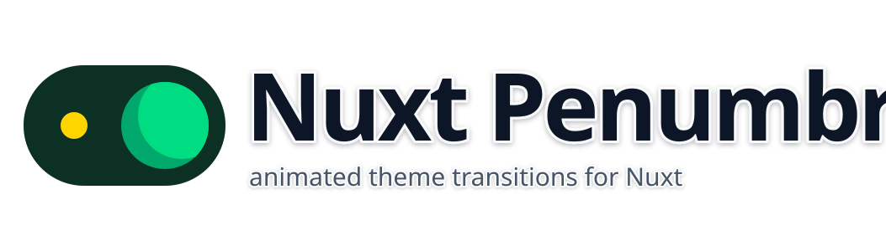
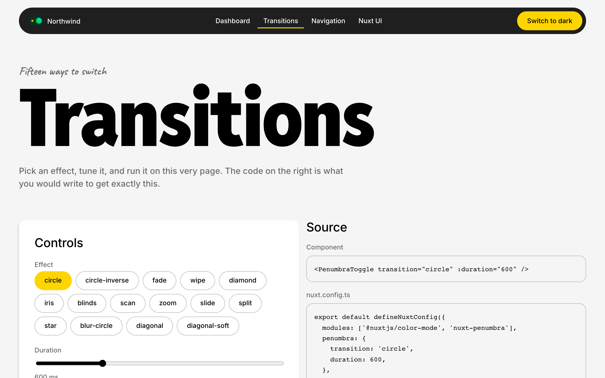
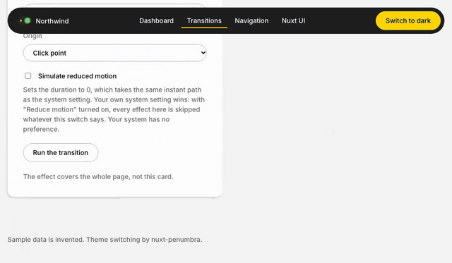
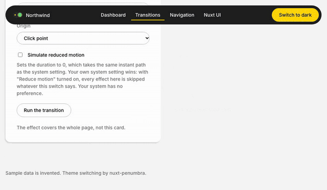

<p align="center">
  
</p>

# nuxt-penumbra

[](https://www.npmjs.com/package/nuxt-penumbra)
[](https://github.com/jantursky/nuxt-penumbra/actions/workflows/ci.yml)
[](https://codecov.io/gh/jantursky/nuxt-penumbra)
[](https://github.com/jantursky/nuxt-penumbra/blob/main/LICENSE)

Animated theme switching for Nuxt, built on the View Transitions API. A circle that grows from the button you clicked, a wipe, blinds, a fade, or an effect you write yourself.

[Docs](https://nuxt-penumbra-docs.vercel.app) · [Demo](https://nuxt-penumbra.vercel.app) · [npm](https://www.npmjs.com/package/nuxt-penumbra) · [Changelog](https://github.com/jantursky/nuxt-penumbra/blob/main/packages/nuxt-penumbra/CHANGELOG.md)

<a href="https://nuxt-penumbra.vercel.app">
  <picture>
    <source media="(prefers-color-scheme: dark)" srcset="https://raw.githubusercontent.com/jantursky/nuxt-penumbra/main/.github/assets/transitions-dark.png">
    
  </picture>
</a>

`@nuxtjs/color-mode` keeps the preference, the storage and the no-flash script, but it cannot animate a switch, and Nuxt UI turns its own transitions off. nuxt-penumbra adds the animation layer on top of what you already use. Without color-mode it keeps a small theme store of its own.

## Install

```bash
npm install nuxt-penumbra @nuxtjs/color-mode
```

```ts
// nuxt.config.ts
export default defineNuxtConfig({
  modules: ['@nuxtjs/color-mode', 'nuxt-penumbra'],
  colorMode: { classSuffix: '' },
  penumbra: { transition: 'circle', duration: 500 },
})
```

```vue
<script setup lang="ts">
const { theme, toggleTheme } = usePenumbra()
</script>

<template>
  <button @click="(event) => toggleTheme({ origin: event })">Theme: {{ theme }}</button>
  <PenumbraToggle transition="wipe" />
</template>
```

Nuxt UI's `UColorModeButton`, `UColorModeSwitch` and `UColorModeSelect` are animated as they are, with no wrapper. Without `@nuxtjs/color-mode` in `modules`, the module runs in standalone mode: it stores the choice in `localStorage`, follows `prefers-color-scheme`, and puts a small script in `<head>` so the page never shows the wrong theme.

## Transitions

Thirty effects ship with the module. They come from [`penumbra-core`](https://github.com/jantursky/astro-eclipse/tree/main/packages/core), the engine that [astro-eclipse](https://github.com/jantursky/astro-eclipse) uses too, so names and options match. Register your own with `definePenumbraTransition`.

<table>
<tr><th>Name</th><th>Preview</th></tr>
<tr><td><code>circle</code></td><td></td></tr>
<tr><td><code>circle-inverse</code></td><td></td></tr>
<tr><td><code>fade</code></td><td></td></tr>
<tr><td><code>wipe</code></td><td></td></tr>
<tr><td><code>diamond</code></td><td></td></tr>
<tr><td><code>iris</code></td><td></td></tr>
<tr><td><code>blinds</code></td><td></td></tr>
<tr><td><code>scan</code></td><td></td></tr>
<tr><td><code>zoom</code></td><td></td></tr>
<tr><td><code>slide</code></td><td></td></tr>
<tr><td><code>split</code></td><td></td></tr>
<tr><td><code>star</code></td><td></td></tr>
<tr><td><code>blur-circle</code></td><td></td></tr>
<tr><td><code>diagonal</code></td><td></td></tr>
<tr><td><code>diagonal-soft</code></td><td></td></tr>
<tr><td><code>square</code></td><td></td></tr>
<tr><td><code>triangle</code></td><td></td></tr>
<tr><td><code>sunburst</code></td><td></td></tr>
<tr><td><code>cross</code></td><td></td></tr>
<tr><td><code>heart</code></td><td></td></tr>
<tr><td><code>ripple</code></td><td></td></tr>
<tr><td><code>clock</code></td><td></td></tr>
<tr><td><code>curtain</code></td><td></td></tr>
<tr><td><code>stairs</code></td><td></td></tr>
<tr><td><code>mosaic</code></td><td></td></tr>
<tr><td><code>blur</code></td><td></td></tr>
<tr><td><code>flip</code></td><td></td></tr>
<tr><td><code>spin</code></td><td></td></tr>
<tr><td><code>cover</code></td><td></td></tr>
<tr><td><code>reveal</code></td><td></td></tr>
</table>

## How it works

1. `src/module.ts` waits until every module is set up (Nuxt UI installs `@nuxtjs/color-mode` as a dependency of its own), then picks the mode, validates the options and registers the plugin, the composable and the component.
2. In color-mode mode the theme is never stored here. `src/runtime/controller.ts` writes `useColorMode().preference` inside the update callback of `document.startViewTransition`, and waits one tick so color-mode's watchers have changed the class before the browser takes the new snapshot.
3. A write that did not come from this module (Nuxt UI's buttons, a `v-model`) is caught by a synchronous watcher in `src/runtime/plugin.client.ts`. It puts the old value back and replays the change inside a view transition, so the old page is still on screen for the snapshot.
4. In standalone mode `src/runtime/standalone.ts` is the store. Writing `preference` saves it, resolves `system`, and updates `<html>` synchronously. `src/runtime/head-script.ts` builds the inline script that applies the stored theme before first paint and follows the system and other tabs.
5. A theme change that arrives while the router is navigating, or while Nuxt's own page transition runs, is applied instantly: two view transitions would cancel each other. Reduced motion and browsers without the API also get the instant switch.
6. The animation itself runs in `penumbra-core`: it plays the chosen effect on `::view-transition-old(root)` and `::view-transition-new(root)` with the Web Animations API, and cancels a running effect before the next one starts.

## Prior art

- [`@nuxtjs/color-mode`](https://color-mode.nuxtjs.org) handles preference, storage and the head script. It has no animated switch, and nuxt-penumbra builds on it.
- [Nuxt UI](https://ui.nuxt.com/docs/components/color-mode-button)'s color-mode components switch instantly, and Nuxt UI registers color-mode with `disableTransition: true`.
- Nuxt's `experimental.viewTransition` animates page navigation, not the theme. The two are kept apart.
- [`css-theme-transition`](https://www.npmjs.com/package/css-theme-transition) and [`@space-man/react-theme-animation`](https://www.npmjs.com/package/@space-man/react-theme-animation) do this for React.
- Many projects hand-write `::view-transition-old(root)` and `::view-transition-new(root)` CSS. This module replaces that code.

## Browser support

| Browser                     | View Transitions                                      | Checked on |
| --------------------------- | ----------------------------------------------------- | ---------- |
| Chromium 159 (Playwright)   | animated                                              | 2026-11-17 |
| WebKit (Playwright build)   | animated                                              | 2026-11-17 |
| Firefox (Playwright build)  | no View Transitions API in this build, instant switch | 2026-11-17 |
| Other browsers and versions | unverified                                            |            |

Without the API the theme switches instantly and nothing throws. Real GPU Chrome for rapid toggling is unverified.

### Nuxt versions and render modes

Each combination below was installed from the packed tarball into a fresh project, built, opened in Chromium and toggled, with the choice checked after a reload. Last run: 2026-11-25. CI repeats it on every push.

| Nuxt                        | Server rendering | `ssr: false` | `nuxt generate` | color-mode `localStorage` + SSR |
| --------------------------- | ---------------- | ------------ | --------------- | ------------------------------- |
| 3.12.4 (the declared floor) | checked          | checked      | checked         | checked                         |
| 3.21.11                     | checked          | checked      | checked         | checked                         |
| 4.7.0                       | checked          | checked      | checked         | checked                         |

Server rendering, `ssr: false` and `nuxt generate` were each run in color-mode mode (cookie storage) and in standalone mode. A fresh install of Nuxt 3.12 resolves a newer `unstorage` that Nuxt 3.12 itself cannot render with, with or without this module, so the 3.12 run pins `unstorage@1.15.0`.

## Not covered yet

- Nuxt versions between the ones in the table above.
- Per-element transitions: the effect always covers the whole page.
- Other tabs follow a theme change only in standalone mode, and without animation. `@nuxtjs/color-mode` does not sync tabs, so in color-mode mode they update on reload.

## Using Astro?

See [astro-eclipse](https://github.com/jantursky/astro-eclipse). It uses the same engine.

<!-- PROJECTS:START -->

## Other Projects & Products

<table align="center">
  <tr>
    <td align="center" valign="top" width="33%">
      <a href="https://github.com/jantursky/" target="_blank" rel="noopener noreferrer">
        <picture>
          <source media="(prefers-color-scheme: dark)" srcset="https://apptiary.com/projects/icons/github-dark.svg">
          
        </picture>
        <br><b>GitHub Profile</b>
      </a>
      <br><sub>Open-source repositories &amp; code</sub>
    </td>
    <td align="center" valign="top" width="33%">
      <a href="https://podcasttotranscript.com/?utm_source=nuxt-penumbra&amp;utm_medium=readme&amp;utm_campaign=other-projects&amp;utm_content=podcast-to-transcript" target="_blank" rel="noopener noreferrer">
        <picture>
          <source media="(prefers-color-scheme: dark)" srcset="https://apptiary.com/projects/icons/podcasttotranscript-dark.svg">
          
        </picture>
        <br><b>Podcast To Transcript</b>
      </a>
      <br><sub>Podcast transcripts, summaries &amp; chapters</sub>
    </td>
    <td align="center" valign="top" width="33%">
      <a href="https://loupekit.com/?utm_source=nuxt-penumbra&amp;utm_medium=readme&amp;utm_campaign=other-projects&amp;utm_content=loupekit" target="_blank" rel="noopener noreferrer">
        <picture>
          <source media="(prefers-color-scheme: dark)" srcset="https://apptiary.com/projects/icons/loupekit-light.svg">
          
        </picture>
        <br><b>LoupeKit</b>
      </a>
      <br><sub>Tech stack, design tokens, AI code checker</sub>
    </td>
  </tr>
  <tr>
    <td align="center" valign="top" width="33%">
      <a href="https://textarray.com/?utm_source=nuxt-penumbra&amp;utm_medium=readme&amp;utm_campaign=other-projects&amp;utm_content=textarray" target="_blank" rel="noopener noreferrer">
        <picture>
          <source media="(prefers-color-scheme: dark)" srcset="https://apptiary.com/projects/icons/textarray-light.svg">
          
        </picture>
        <br><b>TextArray</b>
      </a>
      <br><sub>Online text transformation tool</sub>
    </td>
    <td align="center" valign="top" width="33%">
      <a href="https://addonhive.com/?utm_source=nuxt-penumbra&amp;utm_medium=readme&amp;utm_campaign=other-projects&amp;utm_content=addonhive" target="_blank" rel="noopener noreferrer">
        <picture>
          <source media="(prefers-color-scheme: dark)" srcset="https://apptiary.com/projects/icons/addonhive-dark-v3.svg">
          
        </picture>
        <br><b>AddonHive</b>
      </a>
      <br><sub>Addons &amp; integrations hub</sub>
    </td>
    <td align="center" valign="top" width="33%">
      <a href="https://apptiary.com/mobile/games/?utm_source=nuxt-penumbra&amp;utm_medium=readme&amp;utm_campaign=other-projects&amp;utm_content=mobile-games-and-apps" target="_blank" rel="noopener noreferrer">
        <picture>
          <source media="(prefers-color-scheme: dark)" srcset="https://apptiary.com/projects/icons/stores-dark-v2.svg">
          
        </picture>
        <br><b>Mobile Games &amp; Apps</b>
      </a>
      <br><sub>Android &amp; iOS Applications</sub>
    </td>
  </tr>
  <tr>
    <td align="center" valign="top" width="33%">
      <a href="https://jantursky.com/?utm_source=nuxt-penumbra&amp;utm_medium=readme&amp;utm_campaign=other-projects&amp;utm_content=and-more" target="_blank" rel="noopener noreferrer">
        <picture>
          <source media="(prefers-color-scheme: dark)" srcset="https://apptiary.com/projects/icons/more-dark.svg">
          
        </picture>
        <br><b>And more</b>
      </a>
      <br><sub>More projects, writing &amp; contact</sub>
    </td>
  </tr>
</table>
<!-- PROJECTS:END -->

## License

[MIT](https://github.com/jantursky/nuxt-penumbra/blob/main/LICENSE)
